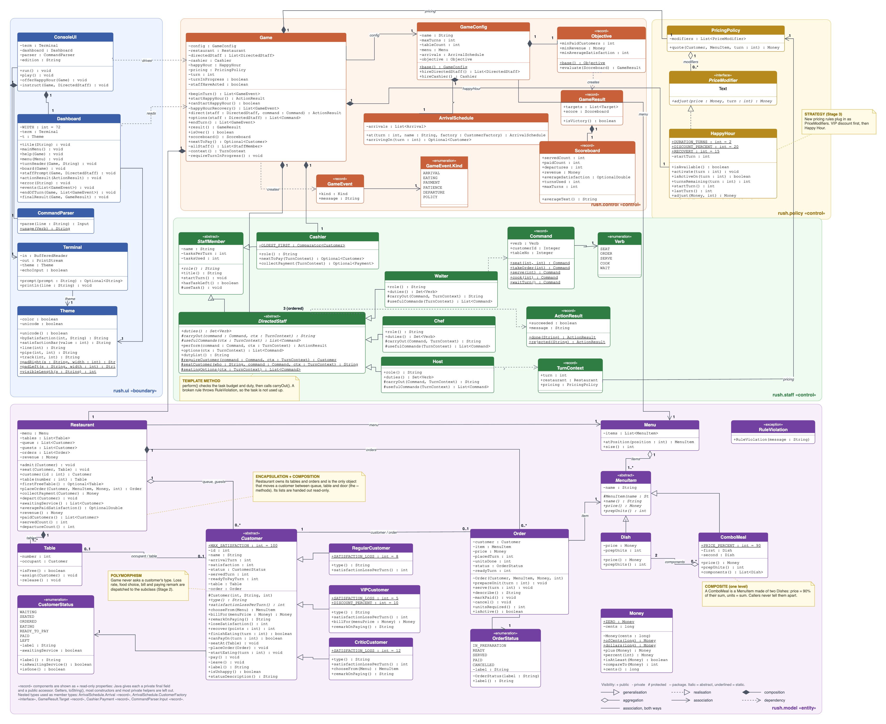

# Restaurant Rush

A turn-based restaurant management game for the command line, built in Java in three
tagged stages for the SC2002 group assignment. You are the manager: every turn you
decide what the Host, Waiter and Chef do, and the Cashier collects payment on their own.
Staff time is scarce, so the real decision is always *who comes first*.

| | |
|---|---|
| **Repository** | https://github.com/theApolloAlien/Restaurant-Rush-SCMA-Group3 |
| **Group** | SCMA · Group 3 |
| **Members** | CCDS LEE SHENG KAI · CCDS LEONG XUAN HAO · CCDS POLOYAPOY RON JOSHUA ABES (Apollo) · CCDS VICTORIA HAUGAA |
| **Report** | [`docs/report/Restaurant-Rush-Report.pdf`](docs/report/Restaurant-Rush-Report.pdf) |
| **Video** | YouTube: *link added after upload* · timestamps [below](#video-timestamps) |
| **Diagrams** | [`docs/diagrams/`](docs/diagrams/): class diagrams for every stage and the six-part sequence diagram |

```
   ╦═╗┌─┐┌─┐┌┬┐┌─┐┬ ┬┬─┐┌─┐┌┐┌┌┬┐  ╦═╗┬ ┬┌─┐┬ ┬
   ╠╦╝├┤ └─┐ │ ├─┤│ │├┬┘├─┤│││ │   ╠╦╝│ │└─┐├─┤
   ╩╚═└─┘└─┘ ┴ ┴ ┴└─┘┴└─┴ ┴┘└┘ ┴   ╩╚═└─┘└─┘┴ ┴
```

---

## Build and run

You need only a JDK, version 17 or newer. There is no build tool to install and no network access is used.

```bash
./run.sh                                         # build and play
./run.sh --script scripts/stage3-victory.txt     # replay a recorded run
./run.sh --plain                                 # no colour, ASCII only (old terminals)
./test.sh                                        # 22 rule checks
```

On Windows, use `run.bat` and `test.bat` (add `--plain` if the console shows odd symbols).
Without the scripts, these two commands work in any shell (bash, cmd or PowerShell) and at every tag:

```bash
javac --release 17 -encoding UTF-8 -sourcepath src -d out src/rush/Main.java
java -cp out rush.Main
```

`javac` starts from `Main` and compiles every class the game uses.

To play an earlier stage, check out its tag and **rebuild** before running. `run.sh` reuses an existing
`restaurant-rush.jar`, which git does not track, so without `./build.sh` you would still be running the
previous stage.

```bash
git checkout stage-1
./build.sh && ./run.sh --script scripts/stage1-victory.txt
git checkout main && ./build.sh
```

On Windows no extra step is needed, because `run.bat` recompiles the sources every time.

## How to play

Each turn shows the dashboard: turn, revenue, paid customers, average satisfaction, the
queue, both tables with satisfaction bars, the kitchen, and the commands each member of
staff can use right now. Then you give each staff member one instruction.

| Command | Who | Meaning |
|---|---|---|
| `seat <customer> [table]` | Host, Waiter | seat a queued customer (default: first free table) |
| `order <customer>` | Waiter | take a seated customer's order (they choose the food) |
| `serve <customer>` | Waiter | serve that customer's READY dish |
| `cook <customer>` | Chef | one preparation unit on that customer's order |
| `wait` | anyone | do nothing this turn |
| `board`, `menu`, `help`, `quit` | — | redraw, show the menu, help, leave |

Short forms are `s 2 1`, `o 2`, `v 2`, `c 2` and `w`. An invalid instruction explains why it
failed and does not use up the task.

**Win** after turn 18 with at least 4 paid customers, revenue of at least $45.00, and an
average satisfaction of paid customers of at least 60.

## Design at a glance

```
rush.ui       ConsoleUI · Dashboard · CommandParser · Terminal · Theme     (boundary: no rules)
rush.control  Game · GameConfig · ArrivalSchedule · Objective · Scoreboard (turn sequence)
rush.staff    StaffMember ◁ DirectedStaff ◁ Waiter, Chef, Host · Cashier   (what each role may do)
rush.policy   PricingPolicy · PriceModifier ◁ HappyHour                    (pricing rules)
rush.model    Restaurant · Table · Customer ◁ Regular/VIP/Critic · Order · MenuItem ◁ Dish/ComboMeal · Money
```

* **Polymorphism**: customer types differ only in `satisfactionLossPerTurn()`,
  `chooseFrom(Menu)`, `billFor(Money)` and `remarkOnPaying()` (plus their `type()` label). The turn
  controller never checks a type.
* **Template method**: `DirectedStaff.perform()` checks the task budget and the role's
  duties, then calls `carryOut()`. A broken rule throws `RuleViolation` and costs nothing.
* **Composite (one level)**: a `ComboMeal` is a `MenuItem` made of two `Dish`es (90% of their price, summed
  units).
* **Encapsulation**: money is integer cents; only `Restaurant` moves customers between the
  queue, a table and the door.

Final class diagram (Stage 3, matches the code on `main`). Click it for the full-size version, or open the
editable [`01-class-diagram.drawio.svg`](docs/diagrams/01-class-diagram.drawio.svg):

[](docs/diagrams/01-class-diagram.png)

Class diagrams for the earlier stages: [Stage 1](docs/diagrams/class-diagram-stage-1.png) ·
[Stage 2](docs/diagrams/class-diagram-stage-2.png).

Sequence diagram (a VIP order during Happy Hour, from arrival to payment and the result check), in six parts:
[1 arrival and seating](docs/diagrams/02-sequence-part-1-arrival-seating.drawio.svg) ·
[2 order and pricing](docs/diagrams/03-sequence-part-2-order-pricing.drawio.svg) ·
[3 READY](docs/diagrams/04-sequence-part-3-ready.drawio.svg) ·
[4 SERVED](docs/diagrams/05-sequence-part-4-served.drawio.svg) ·
[5 eating and payment](docs/diagrams/06-sequence-part-5-eating-payment.drawio.svg) ·
[6 result check](docs/diagrams/07-sequence-part-6-result.drawio.svg).

The `.drawio.svg` files open directly in [diagrams.net](https://app.diagrams.net), the draw.io desktop app or the
VS Code draw.io extension; the Stage 1 and Stage 2 diagrams have `.drawio` sources next to their PNGs.

## Stages and change analysis

| Tag | Adds | Rule checks |
|---|---|:-:|
| `stage-1` | Regular customers, menu, Waiter, Chef, Cashier, full turn sequence, both endings | 12 |
| `stage-2` | `VIPCustomer` (−5/turn, 10% off), `CriticCustomer` (−12/turn, orders the most elaborate dish) | 16 |
| `stage-3` | `Host`, `ComboMeal`, Happy Hour | 22 |

Every tag compiles on its own, passes its own checks, and replays its own victory and defeat
scripts.

### Who built each stage

| Commit | Member | Tag | Content | Date |
|---|---|---|---|---|
| `0fd1d75` | CCDS POLOYAPOY RON JOSHUA ABES (Apollo) | — | Stage 1 (part 1): project setup, domain model, staff roles and pricing | 23 Oct 2026 |
| `f565404` | CCDS LEONG XUAN HAO | `stage-1` | Stage 1 (part 2): turn controller, console UI and rule checks | 26 Oct 2026 |
| `8d0a384` | CCDS LEE SHENG KAI | `stage-2` | Stage 2: VIP and Critic customers dispatched through `Customer` subclasses | 31 Oct 2026 |
| `8f0cce6` | CCDS VICTORIA HAUGAA | `stage-3` | Stage 3: Host, `ComboMeal` (`MenuItem` becomes abstract), Happy Hour pricing policy | 01 Nov 2026 |

### Stage 1 → Stage 2

Compare: https://github.com/theApolloAlien/Restaurant-Rush-SCMA-Group3/compare/stage-1...stage-2
(locally: `git diff stage-1 stage-2 --stat -- src`), commit `8d0a384`.

| File | Change | Why |
|---|---|---|
| `src/rush/model/VIPCustomer.java` | **new** | Loses 5 per turn; `billFor` gives 10% off |
| `src/rush/model/CriticCustomer.java` | **new** | Loses 12 per turn; overrides `chooseFrom` to order the most elaborate dish; star review on payment |
| `src/rush/model/Money.java` | +5 lines | `percent(int)` rounding half-up, first needed for the VIP discount |
| `src/rush/control/GameConfig.java` | small | Registration (two arrival lines and their imports): arrival #2 becomes a Critic and #3 a VIP (still six arrivals) |
| `src/rush/ui/Dashboard.java` | small | Colour per customer type and a guest-type legend (presentation only) |
| `src/rush/Main.java` | 1 line | Edition label |
| `test/rush/RulesTest.java`, `scripts/stage2-*`, docs | updated | New rule checks, Stage 2 runs |
| `Game`, `Customer`, `Restaurant`, `Order`, all staff | **unchanged** | New behaviour is dispatched through the new subclasses |

### Stage 2 → Stage 3

Compare: https://github.com/theApolloAlien/Restaurant-Rush-SCMA-Group3/compare/stage-2...stage-3
(locally: `git diff stage-2 stage-3 --stat -- src`), commit `8f0cce6`.

| File | Change | Why |
|---|---|---|
| `src/rush/staff/Host.java` | **new** | `DirectedStaff` whose only duty is `SEAT`; reuses the shared seating helper |
| `src/rush/model/Dish.java` | **new** | The concrete dish class extracted from `MenuItem` |
| `src/rush/model/ComboMeal.java` | **new** | Two dishes: 90% of the combined price, summed units |
| `src/rush/model/MenuItem.java` | **rewritten** | Concrete class → abstract (`price()`, `prepUnits()`). Its public methods are unchanged, so `Order`, `Chef`, `Waiter` and the Critic need no edits; only the setup in `GameConfig` builds `Dish`es instead |
| `src/rush/policy/PriceModifier.java`, `HappyHour.java` | **new** | Once per game, two turns, 20% off orders taken, +15 recovery for guests still waiting |
| `src/rush/policy/PricingPolicy.java` | changed | Applies `PriceModifier`s after the customer's own discount (VIP first, then Happy Hour) |
| `src/rush/model/Customer.java` | +14 lines | `recover(points)` for Happy Hour (capped at 100) |
| `src/rush/control/Game.java` | changed | Owns Happy Hour; `startHappyHour()` only before any staff acts; recovery at turn start |
| `src/rush/control/GameConfig.java` | small | Registration: menu with two combos; Host hired first |
| `src/rush/control/GameEvent.java` | 1 line | `POLICY` event kind |
| `src/rush/ui/ConsoleUI.java`, `Dashboard.java` | changed | Happy Hour prompt and remaining-duration display; staff with nothing to do wait automatically |
| `src/rush/Main.java` | 1 line | Edition label |
| `test/rush/RulesTest.java`, `scripts/stage3-*`, docs | updated | 6 new rule checks (22 in total), Stage 3 runs |
| `Waiter`, `Chef`, `Cashier`, `DirectedStaff`, `Restaurant`, `Order` | **unchanged** | The Host and combos fit the existing abstractions |

## Reproducible runs

| Script | Result |
|---|---|
| `scripts/stage1-victory.txt` | **Victory**: 5 paid, $66.00, average 79.2 (includes four rejected inputs: two on turn 1, one each on turns 9 and 10) |
| `scripts/stage1-defeat.txt` | **Defeat**: 3 paid, $42.00 |
| `scripts/stage2-victory.txt` | **Victory**: 5 paid, $67.20, average 76.0 (VIP pays $16.20; Critic orders Pasta) |
| `scripts/stage2-defeat.txt` | **Defeat**: 3 paid, $43.20, average 59.3 |
| `scripts/stage3-victory.txt` | **Victory**: 5 paid, $92.16, average 82.6 (Happy Hour on turn 7; VIP Pasta $12.96) |
| `scripts/stage3-defeat.txt` | **Defeat**: 3 paid, $49.50, average 57.0 |

Each script belongs to its own tag. Turn-by-turn notes, and a table showing how different
manager strategies change the result, are in [`docs/TEST_NOTES.md`](docs/TEST_NOTES.md). Full
transcripts are in [`docs/transcripts/`](docs/transcripts/).

## Video timestamps

The video (11:15) covers the seven items in brief §6.2. Everything in the terminal is the real game running.

| # | Segment | Presenter | Start |
|:-:|---|---|---|
| 1 | The game launching from the submitted project | CCDS POLOYAPOY RON JOSHUA ABES (Apollo) | 00:00 |
| 2 | Meaningful manager choices, including a decision where staff are constrained | CCDS POLOYAPOY RON JOSHUA ABES (Apollo) | 01:41 |
| 3 | A dish going READY → SERVED → payment | CCDS LEONG XUAN HAO | 02:42 |
| 4 | A VIP or Critic behaviour (we show both) | CCDS LEONG XUAN HAO | 03:13 |
| 5 | A Stage 3 feature (the Host, a combo and Happy Hour) | CCDS VICTORIA HAUGAA | 03:54 |
| 6 | One victory and one defeat | CCDS VICTORIA HAUGAA | 04:24 |
| 7 | The stage tag comparisons and the diagrams | CCDS LEE SHENG KAI, CCDS LEONG XUAN HAO, CCDS VICTORIA HAUGAA, CCDS POLOYAPOY RON JOSHUA ABES (Apollo) | 04:57 |

Inside segment 7:

| Start | Presenter | Content |
|---|---|---|
| 05:02 | CCDS LEE SHENG KAI | Stage tags and the rule checks |
| 05:17 | CCDS LEE SHENG KAI | Final class diagram: encapsulation, polymorphism, composition, template method |
| 06:08 | CCDS LEONG XUAN HAO | Stage 1 → Stage 2 comparison |
| 07:06 | CCDS VICTORIA HAUGAA | Stage 2 → Stage 3 comparison and this README's change tables |
| 07:36 | CCDS POLOYAPOY RON JOSHUA ABES (Apollo) | Selected use case: serve a VIP customer during Happy Hour |
| 08:22 | CCDS LEE SHENG KAI | Sequence diagram, parts 1–6 |

Contributions and key learning (all four members) start at 09:31.

## Repository layout

```
src/rush/            game source (ui, control, staff, policy, model)
test/rush/           rule checks (plain Java, run with ./test.sh)
scripts/             recorded manager inputs for each stage's victory and defeat runs
docs/TEST_NOTES.md   turn-by-turn notes for the reproducible runs
docs/transcripts/    plain-text transcripts of every scripted run
docs/diagrams/       class diagrams (stages 1–3) and the six-part sequence diagram, editable in draw.io
docs/report/         the report (PDF)
```
